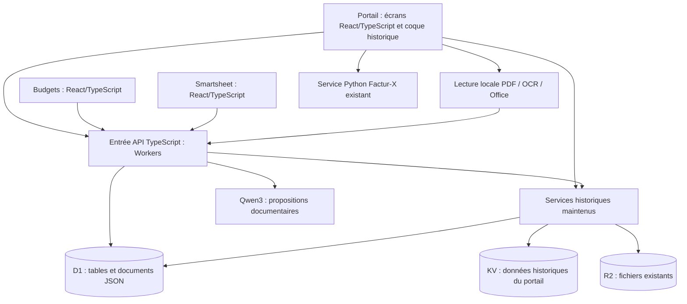
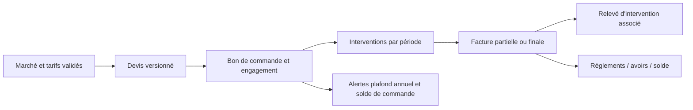

# Architecture de référence — app.cdinnov.eu

**Décision retenue : React/TypeScript + API Cloudflare Workers + D1 + stockage R2.**
**État vérifié au 19 octobre 2026 : migration en cours.**

Ce document fixe la cible technique pour l’ensemble de l’application et distingue ce qui existe de ce qui reste à réaliser. Il remplace les passages devenus obsolètes des premiers rapports de comparaison. Il ne constitue pas un procès-verbal de fin de migration ni de recette complète du logiciel de facturation.

## 1. Décision et raisons

Conserver l’infrastructure en place et remplacer progressivement les composants historiques. Les volumes observés lors de l’audit du 18 octobre restent compatibles avec une petite application d’équipe ; le principal travail porte sur les autorisations, les écritures ciblées et les règles métier.

| Élément | Choix de référence | État réel |
|---|---|---|
| Interface | React et TypeScript ; composants partagés ; modules chargés à la demande | Principaux écrans repris ; coque, connexion et adaptateurs historiques encore présents |
| Construction | Node.js et pnpm en développement ; esbuild et Vite selon les modules | Scripts reproductibles dans le dépôt commun |
| Hébergement statique | Publication GitHub Pages existante sur le domaine de l’application | Conservée ; pas de nouvel hébergeur |
| API | TypeScript sur Cloudflare Workers, organisé par domaine | Entrée commune typée ; délégation à des services JavaScript historiques |
| Données métier | D1, SQL paramétré, migrations versionnées et tables par entité | Tables Marchés/Agenda ; projection Budgets ; plusieurs documents JSON encore sources d’écriture |
| Fichiers | R2 privé, références et empreintes dans la base | Stockage existant conservé ; pièces Marchés encore en blocs dans D1 |
| Identité | Session commune, habilitations contrôlées sur chaque route serveur | Sessions signées pour les API modernes ; ancien mécanisme du portail encore à remplacer |
| Analyse documentaire | Qwen3 via Workers AI, propositions sourcées et validation humaine | Déjà intégré aux marchés |
| PDF, OCR et Excel | Traitement dans le navigateur quand possible ; outils spécialisés conservés | PDF.js, Tesseract et lecteurs Office locaux ; service Python Factur-X séparé |

Node.js sert actuellement à construire et tester les interfaces. Il n’est pas nécessaire de louer un serveur Node permanent pour exécuter l’API quotidienne. Prisma et PostgreSQL ne sont pas des conditions de qualité du logiciel. L’accès actuel repose sur du SQL paramétré ; aucune couche Prisma/Drizzle commune n’est présentée comme déjà déployée.

Un passage à PostgreSQL reste une option si un besoin concret dépasse le modèle transactionnel ou les limites de D1. Il demanderait alors une comparaison sur les opérations réelles, une reprise contrôlée et un plan de retour arrière. Un changement de base seul ne résoudrait pas les conflits d’écriture ni les règles de facturation manquantes.

## 2. Fonctionnement actuel

Les branchements historiques dans ce schéma sont encore actifs. La cible consiste à faire passer chaque lecture ou écriture privée par une identité et des autorisations serveur communes, puis à réduire les documents JSON globaux à des échanges par enregistrement.

## 3. Ce qui est migré, module par module

| Domaine | Reprise livrée de l’interface | Travail restant |
|---|---|---|
| Tableau de bord | Planning équipe, périodes de congés, demandes, derniers documents, portraits, responsive | Évolutions métier et intégration aux futurs engagements |
| CET et salariés | Listes, mouvements, paramètres et principaux formulaires en React/TS | Calculs, imports et accès historiques aux données à déplacer derrière les API communes |
| Congés et déplacements | Calendrier, listes, soldes, demandes et formulaires en React/TS | Certains détails et contrôleurs de sélection restent historiques |
| Notes de frais et facturier | Listes et formulaires React/TS, filtres, tris et pagination | Intégrations pièces, exports, signature, Factur-X et stockage historique |
| Outil budgets | Sources et build React/TS réunis dans le dépôt ; thèmes et responsive | Écritures par entité ; remplacement progressif du document global |
| Smartsheet | Application reconstruite depuis les déclarations du bundle en service ; vues, formulaires, tableaux de bord et sauvegardes | Typage strict intégral des composants repris ; écriture par feuille/ligne ; identité commune |
| Marchés et contrats | Neuf rubriques en React/TS : assistant, identité, pièces, tarifs, plafonds, périodes, conditions, points à confirmer, historique | Contrôleur et moteur métier encore JavaScript ; déplacement des pièces vers R2 ; parcours commandes/interventions/factures |
| Connexion et navigation | Interface harmonisée, mode nuit, symbole triangulaire de connexion corrigé | Reprise de la coque et remplacement du mécanisme d’identité historique |

Les composants Marchés sont vérifiés en TypeScript strict. Leur contrôleur conserve les endpoints, le numéro de version, les règles de validation et le format des enregistrements. React partage son runtime avec les autres écrans du portail et n’est chargé pour les marchés qu’après connexion et habilitation.

Smartsheet dispose d’un contrôle TypeScript de toutes ses sources et d’un contrôle strict séparé de son moteur, de son transport et de sa file de sauvegarde. Certains composants récupérés restent sous inférence permissive. Cette distinction est documentée dans `apps/sheets/README.md`.

## 4. Données, cohérence et conservation

Une seule source accepte les écritures pour chaque domaine. La projection SQL Budgets est alimentée par des triggers dans la transaction du document source : elle n’est pas un second stockage modifiable indépendamment. La migration future doit conserver cette propriété.

| Stockage actuel | Conservation actuelle | Cible |
|---|---|---|
| Portail KV | Document historique conservé avec ses rubriques et pièces référencées | Tables métier et réponses filtrées selon le rôle |
| `budgets_workspace` | Document source avec contrôle de version et ETag | Écritures ciblées sur clients, projets, lignes, dépenses et rapports |
| `app_budget_records` | Projection indexée, synchronisée dans la même transaction | Transition vers les enregistrements faisant autorité après réconciliation |
| Espace Smartsheet | Document complet avec révision ; sauvegardes sérialisées côté navigateur | Espaces, feuilles, lignes et colonnes modifiables séparément |
| Marchés | Versions, pièces, lectures et analyses conservées | Relations vers commandes, interventions et factures ; pièces privées dans R2 |
| Agenda | Déplacements et versions en base | Référentiels et droits communs |

La migration des interfaces ne modifie pas ces sources de données. Les nouvelles vues restent compatibles avec les sauvegardes et contrôles de version existants. Un conflit doit conserver la saisie locale, présenter une erreur et permettre son export ; il ne doit pas écraser automatiquement la version d’un autre utilisateur.

Le déplacement d’une pièce devra procéder par copie, comparaison de taille et d’empreinte, puis changement de référence. Aucun original ne doit être supprimé avant vérification et maintien d’une lecture compatible pendant la transition.

## 5. Identité et droits : prochain chantier prioritaire

Les nouvelles routes disposent de sessions signées et de vérifications de rôle. Cela ne suffit pas à qualifier l’ensemble du portail de totalement modernisé : les anciens accès globaux aux données et fichiers restent une dette de compatibilité.

Le prochain lot doit construire puis tester une passerelle de session et de droits commune, sans exposer les comptes complets au navigateur. Il devra couvrir direction, comptabilité et collaborateur, avec contrôle serveur sur chaque opération et chaque pièce. La visibilité d’un bouton n’est jamais une autorisation suffisante.

Critères de recette : refus des appels anonymes, absence de lecture du dossier d’un autre salarié, maintien des profils et correspondances existants, expiration et déconnexion, réponse tardive ignorée après changement de compte, absence d’accès privé via une ancienne route de contournement. La bascule des anciens accès se fera après validation de tous les modules qui les utilisent.

## 6. Facturation : ce qui reste à construire

Le paramétrage contractuel et le facturier historique existent. Le cycle complet demandé au départ n’est pas encore livré :

Le parcours CCIC devra notamment vérifier les tarifs par lieu/profil, les périodes contractuelles, les commandes partielles, les avenants, les tâches prédéfinies avec complément libre et le relevé associé à chaque facture. Les plafonds annuels du marché et les soldes des bons de commande sont deux suivis distincts. Une facture ne doit pas consommer une seconde fois un montant déjà engagé par une commande.

Les montants et arrondis seront déterministes. Une facture émise conservera ses données historiques. Les opérations concurrentes devront empêcher les doubles émissions et les dépassements d’engagement. L’IA aide à lire les contrats ; elle ne décide pas des calculs ni de l’émission.

## 7. IA et fonctionnement dans les allocations gratuites

Le modèle configuré est `@cf/qwen/qwen3-30b-a3b-fp8`, servi par Cloudflare. Qwen publie ses poids sous licence Apache 2.0 ; le service d’inférence reste soumis aux quotas du fournisseur. Aucune clé Claude/OpenAI n’est nécessaire à cette intégration. Voir la [fiche Cloudflare](https://developers.cloudflare.com/workers-ai/models/qwen3-30b-a3b-fp8/) et la [fiche officielle Qwen](https://huggingface.co/Qwen/Qwen3-30B-A3B).

Les pièces sont lues localement quand le format le permet. Le texte sélectionné est transmis à Cloudflare pour analyse ; ce n’est donc pas une IA entièrement locale. Les propositions sont reliées à des citations et restent ajustables. Une interruption conserve les passages terminés. Une analyse périmée ne peut pas remplacer silencieusement les dernières saisies.

Le module réserve au maximum 5 000 neurones par jour UTC, avec le garde-fou défini dans son code. L’allocation du compte est distincte et peut être partagée avec d’autres applications. Les limites officielles suivantes ont été revérifiées le 19 octobre 2026 :

| Ressource | Allocation / limite gratuite publiée | Conséquence pratique |
|---|---|---|
| Workers | 100 000 requêtes par jour ; 10 ms CPU par invocation HTTP | Éviter les gros traitements et mesurer le CPU par route. [Source](https://developers.cloudflare.com/workers/platform/limits/) |
| D1 | 500 Mo par base ; 5 Go par compte ; ligne limitée à 2 000 000 octets | Normaliser les gros documents JSON avant de rencontrer la limite par ligne. [Source](https://developers.cloudflare.com/d1/platform/limits/) |
| D1, opérations | 5 millions de lignes lues et 100 000 écrites par jour | Indexer les recherches et limiter les réécritures globales. [Source](https://developers.cloudflare.com/d1/platform/pricing/) |
| R2 Standard | 10 Go-mois ; 1 million d’opérations A et 10 millions B par mois | Stocker les fichiers dans R2 et surveiller aussi les opérations. [Source](https://developers.cloudflare.com/r2/pricing/) |
| Workers AI | 10 000 neurones par jour pour le compte | Arrêter/reprendre l’analyse au quota, sans fournisseur payant de secours. [Source](https://developers.cloudflare.com/workers-ai/platform/pricing/) |

Les choix de cette livraison n’ajoutent aucun abonnement ni fournisseur payant. Ils ne prouvent pas que la facture actuelle du compte est nulle : les forfaits, services préexistants et autres usages restent à rapprocher de la facturation du compte. La faible taille des données ne garantit pas, à elle seule, le respect du plafond CPU.

Optimisations déjà présentes : modules chargés à la demande, lectures Budgets conditionnelles par ETag, projection SQL indexée, recherches locales, absence de polling ajouté au tableau de bord, sauvegardes Smartsheet regroupées et sérialisées, analyse documentaire reprenable et exports chargés à la demande.

## 8. Tests, publication et retour arrière

Chaque livraison doit être construite depuis le dépôt, contrôlée en TypeScript et testée avec un serveur local et des données isolées. Les tests Marchés utilisent le Worker complet dans Miniflare et simulent uniquement la réponse du modèle : aucun appel IA payant, notification ou enregistrement en production n’est nécessaire.

Le parcours Marchés couvre la recherche sans requête supplémentaire, la conservation du focus, les montants, les sources obligatoires, les points à confirmer, les conditions, les pièces/doublons/téléchargements, l’application des propositions, les analyses périmées, les exports, les conflits de version, les thèmes et les droits. Le symbole de connexion est vérifié sur mobile et ordinateur.

Avant publication : sauvegarde privée des données et de la configuration ; revue de la différence ; conservation des anciens assets pour les onglets ouverts. Après publication : comparaison des fichiers servis au commit et comparaison des données avant/après. Pour une livraison d’interface, le Worker et les bases n’ont pas à être remplacés.

Le retour arrière republie le frontend précédent. Il ne restaure pas une ancienne base par-dessus les nouvelles saisies. Une migration SQL exige en plus un essai de restauration et un rapprochement des nombres, montants, relations et empreintes avant bascule.

## 9. Ordre de clôture de la migration

1. **Identité et fichiers communs** : remplacer les accès historiques par des autorisations serveur, avec compatibilité testée de tous les profils.
2. **Écritures ciblées** : Budgets, référentiels et Smartsheet, puis données du portail ; supprimer progressivement les documents globaux comme sources d’écriture après réconciliation.
3. **Cycle métier CCIC** : devis, commandes, engagements, interventions, factures, relevés, règlements et alertes, avec transactions et cas de concurrence.
4. **Derniers composants historiques** : coque, connexion, détails de planning, imports et intégrations ; généraliser le typage strict et retirer les chemins de compatibilité devenus inutiles.
5. **Exploitation** : mesure des quotas et du CPU par route, essai de restauration, revue des accès et recette utilisateur de bout en bout.

La migration sera considérée comme terminée quand les accès privés seront contrôlés par le serveur, les écritures métier ciblées et atomiques, les anciennes voies remplacées ou explicitement maintenues, les données réconciliées et les parcours complets testés. La seule conversion des écrans en React ne suffit pas à remplir ces critères.
