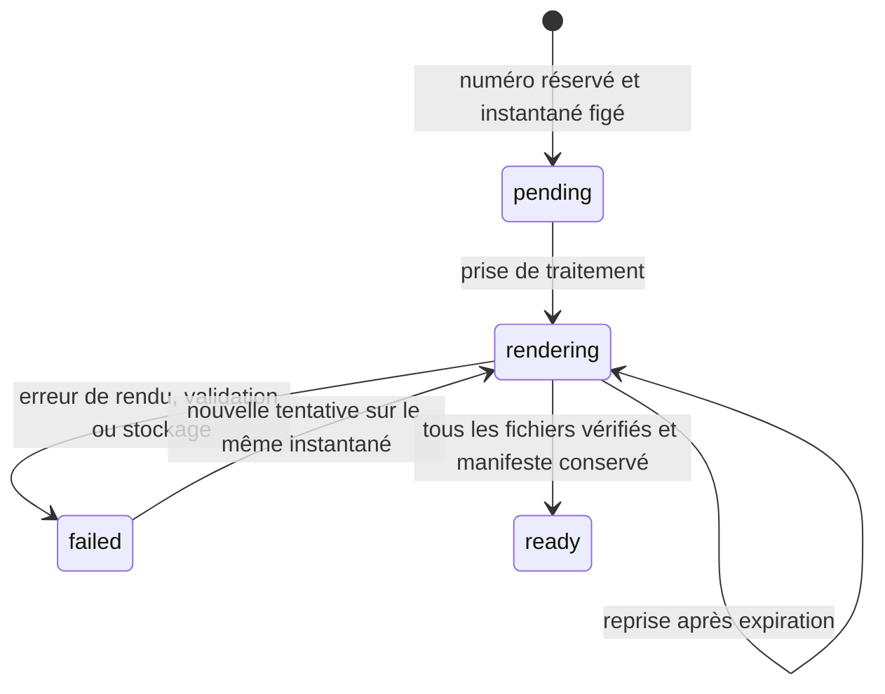

# Émission : contrat de réservation et de reprise

État au 20 octobre 2026 : registre D1, routes HTTP, interface de finalisation, pipeline PDF/A–Factur-X et archivage privé raccordés et testés localement. Aucun déploiement, aucune série de production ni facture réelle créée. La qualification AGIRIS et la reprise de l’historique restent à réaliser.

## Numérotation et conservation

La numérotation utilise une série explicite par émetteur SIREN, type et période. L'administrateur doit fournir préfixe, largeur minimale, premier compteur et dates. Aucune valeur n'est déduite d'un brouillon. La continuité avec les factures historiques doit être vérifiée avant d'activer une série. Les séries concurrentes d'un même type et émetteur sur une période qui se chevauche sont refusées dans cette première version ; aucun besoin de plusieurs séries simultanées n'a été établi.

Les factures nécessitent une numérotation unique, chronologique et continue. Cette règle guide les protections ci-dessous ; la conservation d'une tentative échouée n'est pas présentée comme une qualification juridique de sa date d'émission. [DGFiP, données de facture](https://www.impots.gouv.fr/annexe-c-donnees-de-facture), [Service Public, mentions obligatoires](https://www.service-public.fr/entreprendre/vosdroits/F31808).

Le préfixe est explicite, sans substitution implicite d'année. Le compteur croît au-delà de la largeur minimale jusqu'à 999 999 999 ; au-delà, une erreur impose une décision de configuration. Le numéro reste limité à 35 caractères pour l'adaptateur existant. Un préfixe ne peut être réutilisé pour le même émetteur, y compris pour un autre type. Le compteur et la série ne peuvent être réinitialisés ou supprimés.

## Transaction de réservation

`reserveIssuance` reçoit uniquement un identifiant de tentative, l'identifiant et la version du document, et l'identifiant de série. L'auteur provient de l'identité du serveur. Le navigateur ne fournit ni numéro, ni instantané, ni total. Le point d’entrée HTTP `/documents/:id/issue` vérifie d’abord la configuration du moteur et du stockage, puis exécute le contrôle préalable du service sur la version exacte. Une indisponibilité, une redirection ou un contrôle incomplet ne réserve aucun numéro. Une modification concurrente rend cette réservation impossible.

1. Récupérer une tentative existante si les quatre identifiants correspondent. Une clé réemployée pour un autre document, une autre version ou une autre série est un conflit.
2. Lire et normaliser le brouillon, refuser les informations incomplètes et recalculer les totaux. Pour une facture, appliquer les contrôles de l'adaptateur Factur-X. La validation complète Python/XSD/Schematron/PDF-A reste une étape de service supplémentaire.
3. Exécuter une seule instruction `INSERT … SELECT` conditionnée à la version et au JSON source exact. Les déclencheurs vérifient type, émetteur, période, chronologie et compteur. La base compose elle-même le numéro.
4. Dans cette même transaction, inscrire l'instantané immuable, incrémenter la série et créer le travail ainsi que son événement initial. Si une écriture échoue, toutes sont annulées.
5. Dès la réservation, tout écrivain SQL vers le document source est refusé. Une tentative concurrente ou une réponse perdue ne crée pas de second numéro. Les documents historiques et versions antérieures sont conservés.

Le modèle de brouillon `billing_documents` conserve son schéma historique. Le verrou effectif est la présence du document dans `billing_issuances`. L’API et les listes présentent l’état calculé depuis le registre et son travail : `draft`, `finalizing`, `issue_failed`, `issued`. Un document figé ouvre une fiche de consultation ; l’API refuse toute réécriture et le PDF de brouillon n’est plus accessible.

## Reprise durable

Chaque tentative reçoit un jeton unique, jamais réutilisable, et une échéance de traitement. Un seul processus le détient à la fois. Après expiration, une nouvelle tentative peut reprendre. Une réponse de l'ancien processus ne peut ni finaliser ni mettre en échec le nouveau traitement. La réussite est terminale. Tous les changements sont inscrits dans un journal immuable dans la même transaction.

L’orchestrateur `billing-generation.ts` écrit puis relit chaque objet privé et compare taille, type MIME et SHA-256 avant `completeIssuanceJob`. Le manifeste et l’état `ready` ne prouvent aucune remise à AGIRIS. Les tests de registre utilisent encore des manifestes fictifs explicitement identifiés ; le test d’intégration distinct utilise FastAPI, Ghostscript, Factur-X, veraPDF et R2 local réels.

## Fichiers et empreintes

L’empreinte de l’instantané couvre document normalisé et totaux, sérialisés en JSON canonique UTF-8 (clés d’objet triées récursivement, ordre des tableaux conservé). Le contrat croisé Python/TypeScript est testé. Une seconde empreinte, calculée depuis les champs immuables, couvre également le numéro définitif, l'émetteur, l'identifiant de tentative, le document source, sa version et la date. Le manifeste est lié à cette seconde empreinte.

Un devis exige son PDF. Une facture exige PDF Factur-X, XML, rapport de validation JSON et rapport veraPDF XML. Les références utilisent des clés privées `billing/<émission>/<type>/<sha256>` et des tailles bornées ; les URLs arbitraires et chemins externes sont refusés. Les empreintes ne remplacent pas les contrôles de contenu ni la preuve d'écriture du stockage.

Le service `/api/billing/generate-issued`, réservé à la clé serveur, recalcule les deux empreintes et les montants. Il génère le PDF et le XML à partir de ce même instantané, puis exécute XSD, Schematron France, incorporation XML et veraPDF. Le Worker contrôle l’enveloppe, les fichiers et le rapport avant archivage. Les téléchargements authentifiés revérifient l’empreinte en stockage. Les routes historiques `/files/billing/*` sont interdites en lecture, écriture et suppression. Les tolérances de reconnaissance des anciens PDF ne sont pas applicables à ces documents structurés. Un téléchargement ne marque pas une transmission, et un paiement ne change aucune empreinte documentaire.

## Tests et limites restantes

`billing-issuance-test.mjs` vérifie la migration sans perte, la configuration idempotente, les écritures simultanées, les doublons, le retour de date, le mauvais émetteur/type, les conflits avec une modification, le rollback sur échec du journal, l'interdiction de réécriture, les traitements expirés, le rejet des réponses tardives, l'immuabilité après réussite et l'épuisement du compteur.

`billing-generation-test.mjs` vérifie les droits avant tout appel distant, les refus de précontrôle sans consommation de numéro, une modification pendant ce contrôle et le rejet de fichiers/rapports incohérents. `billing-issue-integration-test.mjs` traverse navigateur, Worker/D1, moteur natif complet et R2 ; une panne simulée est reprise sous le même numéro, puis le vrai Factur-X est contrôlé. Le lecteur PDF couvre pagination, zoom, erreur puis reprise d’affichage et invalidation de l’aperçu lors d’une modification du brouillon.

Restent à qualifier : service et stockage déployés, séquences réelles rapprochées, acceptation AGIRIS, cycle complet devis/avoirs/acomptes/paiements et allocations. Les endpoints ne transmettent aucun document à un destinataire externe.
