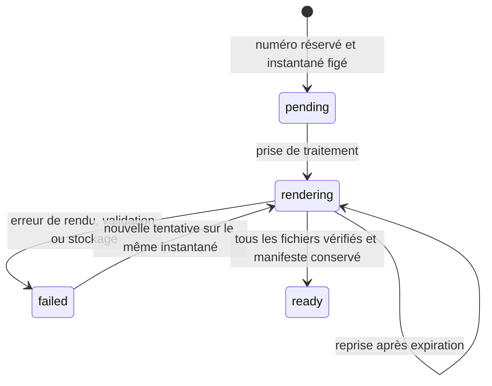

# Émission : contrat de réservation et de reprise

État au 20 octobre 2026 : socle interne implémenté et testé sur D1 local. Aucune route HTTP d'émission ni action utilisateur ne l'appelle encore. Aucune série de production créée. La génération des fichiers définitifs, leur vérification en stockage privé et la transition utilisateur « émis » restent à raccorder.

## Numérotation et conservation

La numérotation utilise une série explicite par émetteur SIREN, type et période. L'administrateur doit fournir préfixe, largeur minimale, premier compteur et dates. Aucune valeur n'est déduite d'un brouillon. La continuité avec les factures historiques doit être vérifiée avant d'activer une série. Les séries concurrentes d'un même type et émetteur sur une période qui se chevauche sont refusées dans cette première version ; aucun besoin de plusieurs séries simultanées n'a été établi.

Les factures nécessitent une numérotation unique, chronologique et continue. Cette règle guide les protections ci-dessous ; la conservation d'une tentative échouée n'est pas présentée comme une qualification juridique de sa date d'émission. [DGFiP, données de facture](https://www.impots.gouv.fr/annexe-c-donnees-de-facture), [Service Public, mentions obligatoires](https://www.service-public.fr/entreprendre/vosdroits/F31808).

Le préfixe est explicite, sans substitution implicite d'année. Le compteur croît au-delà de la largeur minimale jusqu'à 999 999 999 ; au-delà, une erreur impose une décision de configuration. Le numéro reste limité à 35 caractères pour l'adaptateur existant. Un préfixe ne peut être réutilisé pour le même émetteur, y compris pour un autre type. Le compteur et la série ne peuvent être réinitialisés ou supprimés.

## Transaction de réservation

`reserveIssuance` reçoit uniquement un identifiant de tentative, l'identifiant et la version du document, et l'identifiant de série. L'auteur provient de l'identité du serveur. Le navigateur ne fournit ni numéro, ni instantané, ni total. Cette fonction est interne : le futur point d'entrée devra d'abord vérifier la disponibilité des moteurs et exécuter leur contrôle préalable sur la version exacte.

1. Récupérer une tentative existante si les quatre identifiants correspondent. Une clé réemployée pour un autre document, une autre version ou une autre série est un conflit.
2. Lire et normaliser le brouillon, refuser les informations incomplètes et recalculer les totaux. Pour une facture, appliquer les contrôles de l'adaptateur Factur-X. La validation complète Python/XSD/Schematron/PDF-A reste une étape de service supplémentaire.
3. Exécuter une seule instruction `INSERT … SELECT` conditionnée à la version et au JSON source exact. Les déclencheurs vérifient type, émetteur, période, chronologie et compteur. La base compose elle-même le numéro.
4. Dans cette même transaction, inscrire l'instantané immuable, incrémenter la série et créer le travail ainsi que son événement initial. Si une écriture échoue, toutes sont annulées.
5. Dès la réservation, tout écrivain SQL vers le document source est refusé. Une tentative concurrente ou une réponse perdue ne crée pas de second numéro. Les documents historiques et versions antérieures sont conservés.

Le modèle de brouillon `billing_documents` conserve son schéma historique. Le verrou effectif est la présence du document dans `billing_issuances`. Le futur raccordement HTTP/UI doit présenter l'état calculé depuis ce registre et le travail associé, jamais le seul champ historique `status='draft'`. Ce point est une condition préalable à l'exposition de l'émission.

## Reprise durable

Chaque tentative reçoit un jeton unique, jamais réutilisable, et une échéance de traitement. Un seul processus le détient à la fois. Après expiration, une nouvelle tentative peut reprendre. Une réponse de l'ancien processus ne peut ni finaliser ni mettre en échec le nouveau traitement. La réussite est terminale. Tous les changements sont inscrits dans un journal immuable dans la même transaction.

L'état `ready` signifie que le travail local possède un manifeste ; il ne prouve aucune remise à AGIRIS. Les tests de ce socle utilisent des manifestes fictifs explicitement identifiés. Le raccordement de production doit écrire et relire les objets privés avant d'appeler `completeIssuanceJob`.

## Fichiers et empreintes

L'empreinte de l'instantané couvre document normalisé et totaux. Une seconde empreinte, calculée depuis les champs immuables, couvre également le numéro définitif, l'émetteur, l'identifiant de tentative, le document source, sa version et la date. Le manifeste est lié à cette seconde empreinte.

Un devis exige son PDF. Une facture exige PDF Factur-X, XML, rapport de validation JSON et rapport veraPDF XML. Les références utilisent des clés privées `billing/<émission>/<type>/<sha256>` et des tailles bornées ; les URLs arbitraires et chemins externes sont refusés. Les empreintes ne remplacent pas les contrôles de contenu ni la preuve d'écriture du stockage.

La future chaîne doit vérifier le numéro, les dates, les parties, les montants et les pièces produites contre l'enveloppe immuable. Les tolérances de reconnaissance des anciens PDF ne sont pas applicables à ces documents structurés. Un téléchargement ne marque pas une transmission, et un paiement ne change aucune empreinte documentaire.

## Tests et limites restantes

`billing-issuance-test.mjs` vérifie la migration sans perte, la configuration idempotente, les écritures simultanées, les doublons, le retour de date, le mauvais émetteur/type, les conflits avec une modification, le rollback sur échec du journal, l'interdiction de réécriture, les traitements expirés, le rejet des réponses tardives, l'immuabilité après réussite et l'épuisement du compteur.

Prochain raccordement : contrôle préalable complet du service, fichiers réels en stockage privé, orchestration avec reprises, droits et préconditions HTTP, état effectif dans listes/éditeur, détail de finalisation et téléchargement authentifié. Ensuite : séquences réelles vérifiées, cycle des devis, avoirs/acomptes et allocations. Aucun de ces points n'est déclaré terminé par ce seul socle.
